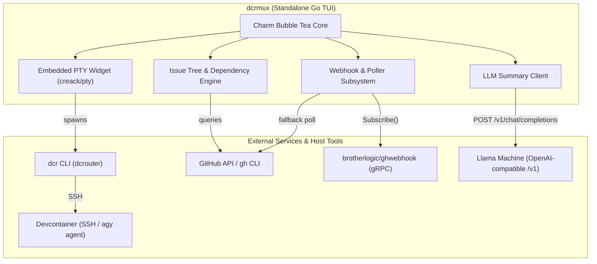

# DCRMux - Project Intent & Scope

## 1. Executive Summary

`dcrmux` is a terminal multiplexer and workflow hub designed to streamline AI-assisted software development in the `brotherlogic` ecosystem. It unifies context across GitHub issue trees, AI-generated issue summaries, and active devcontainer sessions into a cohesive, responsive terminal user interface (TUI).

Currently, developers work across detached contexts: navigating issue hierarchies on GitHub, keeping track of task dependencies, and invoking `dcr <repo> <issue>` in disparate terminal tabs. `dcrmux` centralizes this entire loop into a single 3-pane TUI that:
1. Automatically tracks and displays issue trees and their unblocked leaves.
2. Generates and displays crisp, high-level summaries for the active task using a local LLaMA endpoint.
3. Hosts the interactive SSH conversation with the development agent (`agy`) inside an embedded terminal emulator.
4. Reacts in real time to GitHub state changes (via `ghwebhook`), automatically advancing the developer to the next unblocked issue as tasks close.

---

## 2. System Architecture



### Key Technical Choices
- **Language & Runtime**: Go (consistent with `dcrouter`, `devcontainer-manager`, and `ghwebhook`).
- **TUI Framework**: Charmbracelet's [Bubble Tea](https://github.com/charmbracelet/bubbletea), with [Lip Gloss](https://github.com/charmbracelet/lipgloss) for styling and [Bubbles](https://github.com/charmbracelet/bubbles) for component widgets.
- **Terminal Emulation**: `creack/pty` handling pseudo-terminal creation and raw I/O piping to the interactive `dcr` process.
- **Summary Provider**: Local LLaMA instance exposing an OpenAI-compatible HTTP endpoint (`/v1/chat/completions`).
- **Event Bus**: Streaming gRPC connection to `brotherlogic/ghwebhook`, augmented by a resilient GitHub polling fallback.

---

## 3. User Interface & Layout Specification

The interface is structured into three distinct panes across a full terminal window:

```
+--------------------------+-------------------------------------------------------+
| LEFT PANE                | TOP-RIGHT PANE (Summary)                              |
| (25-30% Width)           | (~25% Height)                                         |
|                          | Issue #6: Implement pstore serialization              |
| Issue Trees & Leaves     | Summary: Two-paragraph executive summary generated by |
|                          | llama explaining context and task scope.              |
| brotherlogic/dcrmux      | Metadata: Repo, Branch, Labels, Assignee              |
|   #1 Project Setup [x]   +-------------------------------------------------------+
| > #6 PStore Layer [*]    | BOTTOM-RIGHT PANE (Active Conversation)               |
|   #7 gRPC Handler        | (~75% Height)                                         |
|                          |                                                       |
| brotherlogic/music       | devcontainer: dcrmux-6 (container-ready)              |
|   #42 Audio Sync         | $ agy --dangerously-skip-permissions ...              |
|                          | > Agent running tests...                              |
|                          |                                                       |
|                          |                                                       |
|                          |                                                       |
+--------------------------+-------------------------------------------------------+
```

### Panes Breakdown
1. **Left Pane (Issue Tree & Leaf Selector)**:
   - Occupies the full height, 25-30% width.
   - Displays tracked repositories and their active issue trees.
   - Highlights the current unblocked leaf for each tree.
   - Supports keyboard selection and tree expansion.
2. **Top-Right Pane (Summary View)**:
   - Occupies ~25% height of the right column.
   - Displays issue/PR title, labels, target branch, and a 2-paragraph LLM-generated summary.
   - Gracefully displays raw issue markdown text while LLM generation is in flight or if the LLM is unreachable.
3. **Bottom-Right Pane (Agent Conversation View)**:
   - Occupies ~75% height of the right column.
   - Hosts an embedded PTY running `dcr <repo> <issue>`.
   - Passes full interactive ANSI keystrokes directly to the agent / shell session.
   - Renders a spinner / waiting screen when the target container is still in `container-creating` state.

---

## 4. Interaction Model & Navigation

- **Focus Default**: By default, keyboard focus is routed directly to the bottom-right terminal pane for frictionless interaction with `agy` or the shell.
- **Command Prefix (`Ctrl+B`)**:
  - Pressing `Ctrl+B` escapes focus from the PTY into the left pane.
  - In the left pane, the user can navigate issue trees using arrow keys or `j` / `k`.
  - Pressing `Enter` selects the highlighted issue/PR:
    - Tears down the active `dcr` session in the bottom-right pane.
    - Updates the top-right pane with the new issue details and requests an LLM summary.
    - Launches `dcr` for the selected issue and immediately refocuses input into the conversation pane.
  - Pressing `Esc` or `Ctrl+B` again cancels navigation and returns focus directly to the terminal pane.
- **Auto-Advancement**:
  - When the active issue is marked closed in GitHub (via PR merge or explicit close event received from `ghwebhook`), `dcrmux` immediately updates the tree view.
  - It terminates the existing `dcr` session and automatically transitions to the next unblocked leaf issue in the tree.
- **Container Readiness Handling**:
  - If the next container is not yet in `container-ready` status (e.g. `devcontainer-manager` is still provisioning it), the conversation pane displays a pulsing spinner with status: `Waiting for container-ready on <repo>-<issue>...`.
  - Once `container-ready` is detected, `dcr` is spawned automatically.
- **Dropped Connection Handling**:
  - If the SSH connection terminates unexpectedly, an inline banner appears in the pane: `SSH session ended. Press [r] to reconnect or [Ctrl+B] to switch issues.`

---

## 5. Issue Tree & Dependency Resolution

1. **Hierarchy Discovery**:
   - `dcrmux` inspects parent/root issues (e.g., `[Breakdown]`, `[Implementation Plan]`, or top-level feature epics).
   - Dependencies are identified by parsing GitHub tasklists (`- [ ] #123`) or native GitHub sub-issues.
2. **Leaf Ordering & Blocking Logic**:
   - Open leaves are ordered sequentially by issue number.
   - Older/lower issue numbers are assumed to block newer/higher numbers within the tree.
   - The lowest-numbered open issue in each branch is designated as the next unblocked task.
3. **Pull Request Representation**:
   - When a PR is opened for an issue (referencing `Closes #X` or branch `feature/*_<issue>`), the PR is represented as an attached child leaf of the issue in the tree.
   - Selecting a PR leaf attaches to the PR container.

---

## 6. Real-Time Updates & Integration Contracts

### `brotherlogic/ghwebhook`
- `dcrmux` establishes a streaming gRPC connection to `ghwebhook.v1.RegistrationService` / event stream.
- Listens for `IssueEvent` and `PullRequestEvent` updates for the tracked repositories.
- Emits Bubble Tea messages (`tea.Msg`) into the UI update loop on incoming events.
- **Fallback Polling**: If the gRPC connection drops or is unreachable, `dcrmux` periodically polls the GitHub API every 45 seconds.

### Llama Summarization Endpoint
- Endpoint: OpenAI-compatible HTTP endpoint (e.g., `http://llama:11434/v1/chat/completions` or configured host).
- Request prompt: Requests a strictly formatted 2-paragraph executive summary highlighting:
  1. The architectural goal and background context.
  2. The specific deliverables and acceptance criteria for this slice.
- Result is cached in memory per issue ID and commit/update timestamp.

### `dcr` / `dcrouter`
- Invoked as an external subprocess via `creack/pty`:
  `dcr <repo> <issue_number>`
- Inherits the user's terminal environment and SSH authentication keys.

---

## 7. Scope Boundaries

### In Scope
- Standalone Go binary (`dcrmux`) installable via `go install`.
- 3-pane Bubble Tea TUI with dynamic terminal resizing.
- Full PTY terminal virtualization for running `dcr`.
- GitHub issue tree parsing and dependency ordering.
- Real-time `ghwebhook` streaming with polling fallback.
- Llama-based 2-paragraph issue summarization with fallback to raw markdown.
- `Ctrl+B` command-key pane navigation and auto-advancing upon issue closure.

### Out of Scope (Future Phases)
- Creating, editing, or commenting on GitHub issues directly from `dcrmux` (delegated to `agy` or `gh` CLI).
- Managing devcontainer provisioning directly (delegated to `devcontainer-manager`).
- Multi-user remote sharing or web-based UI.
