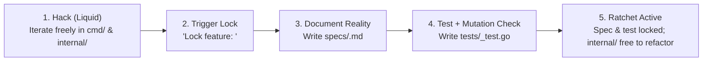

# Liquid-to-Crystal: Feature-Locking Workflow

This document summarizes the development workflow designed for `dcrmux` (replacing the upfront `INTENT.md` + `MILESTONES.md` Waterfall approach).

---

## 1. Why We Replaced Upfront Specs (`INTENT.md` / `MILESTONES.md`)

Traditional Spec-Driven Development requires writing 20–30 KB of exhaustive Markdown specifications (`VISION.md` $\rightarrow$ `INTENT.md` $\rightarrow$ `MILESTONES.md` $\rightarrow$ `PHASE1-4.md`) before a single line of `.go` code exists. That creates two problems:
1. **Upfront Spec Fatigue:** Negotiating hundreds of lines of abstract prose burns creative momentum before Day 1 of coding, leaving repos stalled with 0 `.go` files.
2. **Hallucinated Contracts:** Upfront specs written in a vacuum inevitably guess wrong about how a TUI feels or how external services actually behave (e.g., the old `INTENT.md` assumed `ghwebhook` used a streaming `Subscribe()` RPC rather than unary `Register` + `WebhookHandler.ReceiveWebhook`).

At the same time, **coding with zero spec doesn't work either**—without guardrails, agents drift into generic slop or break previously working behaviors when adding new ones.

The solution is **Gradual Crystallization (The Feature-Locking Ratchet)**: start with a concise `GOAL.md` (core UX + hard architectural guardrails), build the real Go binary in fast, unconstrained loops (**Liquid Mode**), and ratify working behaviors into specs and tests **after** they prove themselves in reality (**Crystal Mode**).

---

## 2. How This Differs from Matt Pocock's `/prototype` $\rightarrow$ `/to-spec`

| Dimension | Matt Pocock's `/prototype` $\rightarrow$ `/to-spec` | `dcrmux` Feature-Locking Ratchet |
| :--- | :--- | :--- |
| **What gets built** | Throwaway single-file `.html` button demo | The actual Go TUI binary (`cmd/dcrmux`, `internal/`) |
| **Fate of prototype** | Stashed on a dead branch and discarded | Evolves in-place on `main` into production code |
| **How specs are written** | Synthesizes a long list of prose User Stories upfront | Extracts concise behavioral specs + black-box tests from working features |
| **Lock granularity** | All-at-once transition from Prototype to Tickets | Feature-by-feature ratchet (`internal/` stays liquid while locked features stay protected) |

---

## 3. The 4-Step Feature-Locking Loop

Instead of locking directories or packages (which are implementation details that should stay easy to refactor), we lock **user-visible features (behaviors)**.

### Step 1: Hack (`Liquid Mode`)
- Work directly on the real Go binary (`cmd/`, `internal/`) guided by [`GOAL.md`](./GOAL.md).
- Skip formal spec writing and test ceremony while exploring how a feature feels in the terminal.
- Keep iteration loops under 2 minutes until the behavior works the way you want.

### Step 2: Trigger the Lock
- Once a specific behavior works and feels right (e.g., `three-pane-layout` or `auto-advance-on-close`), explicitly trigger a feature lock:
  > *"Lock feature `three-pane-layout`: responsive 3-pane layout with `Ctrl+B` toggling focus between the left tree pane and bottom-right PTY pane."*

### Step 3: Document Reality (`specs/<feature>.md`)
- The agent inspects the **working code paths** and writes `specs/<feature>.md` capturing:
  - Trigger conditions / inputs.
  - Exact state transitions and observable outputs.
  - Edge cases handled by the working implementation.
- Because this documents code you just used and verified, reviewing it takes seconds.

### Step 4: Black-Box Tests & Mutation Verification (`tests/<feature>_test.go`)
- The agent writes a black-box behavioral test in `tests/<feature>_test.go` against the highest public seam (never coupling to private structs/functions inside `internal/`).
- **Mutation Verification ("Teeth Check"):** Before committing the lock, the agent temporarily breaks the core logic in `internal/`, runs `go test ./tests/...` to prove the new test fails, and restores `internal/`.

### Step 5: The Ratchet
- Once locked, `specs/<feature>.md` and `tests/<feature>_test.go` act as immutable guardrails (compatible with `speculate`'s `CODEOWNERS` / `review-gate` pattern).
- **`internal/` remains 100% unlocked:** future prototyping can freely refactor packages, rename types, or add new features as long as all locked tests in `tests/` stay green.
- **Unlocking:** If you ever want to intentionally change a locked behavior, explicitly unlock that feature, modify the behavior in `internal/`, and re-lock its spec and test.
